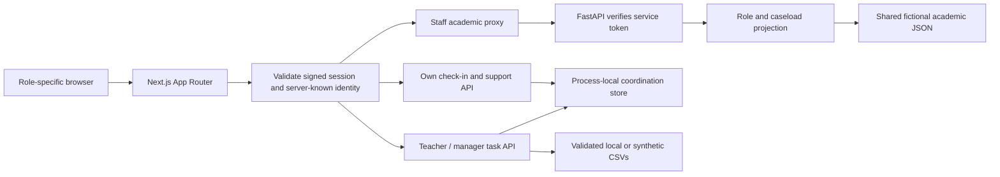
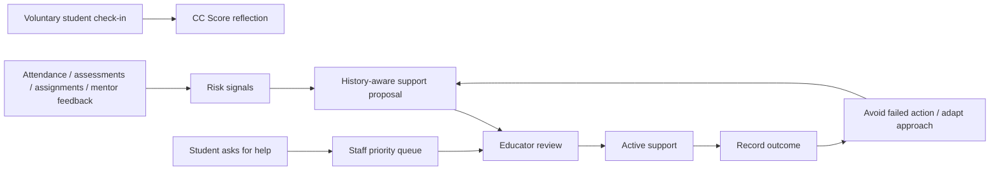

# Architecture

## Runtime boundaries

Mentors never receive academic evidence or other caseloads from Python. The student proxy is denied to students. Student check-in endpoints derive identity from the signed session; staff cannot read them. Staff task responses project the minimum private-request information. Raw quiz answers never enter staff task responses. The fictional mentoring wellbeing examples are a separate dataset, with assigned-mentor details and consented staff summaries.

## Detection → recommendation → outcome → adaptation

Academic risk/recommendation examples are fixtures; the CSV queue uses explicit thresholds. Failed exact actions for the same issue are blocked in the academic UI. CSV exclusions are conservative per student because the source lacks issue codes. Active support is reviewed before adding more. No ML/LLM service or scheduled ingestion exists.

CC Score is independent of academic risk and never changes grades or eligibility. A student can skip the quiz or withhold data and still ask for help. Private requests receive a dedicated lane and a tie-break within the same urgency level; urgent academic cases retain priority.

## State and deployment limits

- Academic API: read-only, validated shared JSON.
- Academic intervention UI and fictional mentor examples: browser-memory edits.
- Student check-ins, support requests and staff task changes: process-local server Map, shared across account sign-out, reset on restart, unsuitable for multiple replicas.
- Optional imported CSVs: ignored server-only files; safe synthetic defaults are tracked.
- Public research context: aggregate sourced snapshot; never joined to individual records.
- Authentication: intentionally public demo chooser and HMAC sessions, not institutional authentication.
- Notifications/reminders: simulated; no outbound messages or automatic interventions.

A future deployment needs institutional identity, managed secrets, database transactions, consent/audit records and durable intervention/coordination APIs. Those are boundaries for future work, not features claimed by this package.
